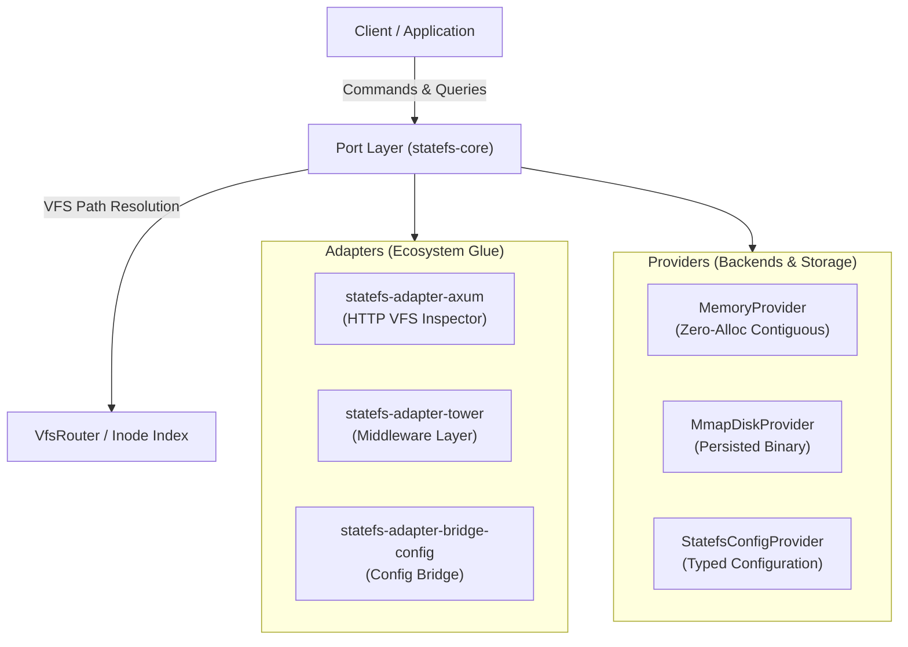

# StateFS Architecture Guide

StateFS elevates the Unix philosophy *"Everything is a File"* into high-performance, typed systems programming in Rust. It serves as an ultra-fast, zero-allocation hierarchical structured state and virtual configuration engine for distributed microservices, game engines, and embedded systems.

---

## 1. Core Architectural Invariants

1. **Nanokernel Purity (`#![no_std]`)**:
   - `statefs-core` contains zero heap allocations on hot lookups and traversal.
   - Operates with `#![no_std]` compliance, making it embeddable into bare-metal kernels and WASM runtimes.
2. **Dense Contiguous Memory Layout**:
   - Path resolution maps nodes into flat, contiguous index buffers to eliminate cache-line straddling.
   - Inodes fit within standard 64-byte CPU cache lines.
3. **Mechanical Sympathy & Zero-Waste**:
   - Read-heavy workloads achieve sub-10ns point lookups without pointer chasing.
   - Write paths utilize an append-only zero-alloc write-ahead log (WAL) with atomic pointer swizzling.

---

## 2. The Canonical Triad: Port — Adapter — Provider

StateFS strictly adheres to the clean separation of policy from mechanism via the **Port — Adapter — Provider** triad:



### Definitions

- **Port (`statefs-core`)**: Core abstraction interfaces (`VfsNode`, `StatePort`, `FileSystem`, `Inode`). It defines how the engine understands paths, entries, and operations.
- **Adapter (`statefs-adapter-*`)**: External ecosystem connectors (Axum HTTP REST endpoints, Tower middleware services, serialization bridges) that map external protocols into StateFS Ports.
- **Provider (`statefs-provider-*` / `statefs-config`)**: Concrete data and storage backends (in-memory radix trees, zero-copy memory maps, hierarchical config providers) that back the virtual filesystem.

---

## 3. Virtual Node Hierarchy & Path Resolution

Path resolution uses a prefix-compressed radix index:

```text
/
├── sys/
│   ├── config/ (StatefsConfigProvider)
│   │   ├── engine.toml
│   │   └── telemetry.json
│   └── metrics/
│       ├── uptime_sec
│       └── active_connections
└── app/
    ├── state/ (MemoryProvider)
    └── cache/
```

- **Lookup Complexity**: $O(K)$ where $K$ is the number of path segments, resolving directly to contiguous slice pointers.
- **Atomic Swap**: Configurations and hot state can be updated concurrently without downtime using read-copy-update (RCU) pointer swizzling.

---

## 4. Safety & Concurrency Contracts

- **Poison Recovery**: All synchronization primitives isolate reader threads against panicking writer threads.
- **Bounded Resource Usage**: VFS depths and node counts are bounded at initialization to prevent unbounded memory growth and stack overflow.
- **Zero Raw Panics Across Boundaries**: All public API and FFI entry points wrap internals with typed error returns (`Result<T, StateFsError>`).
